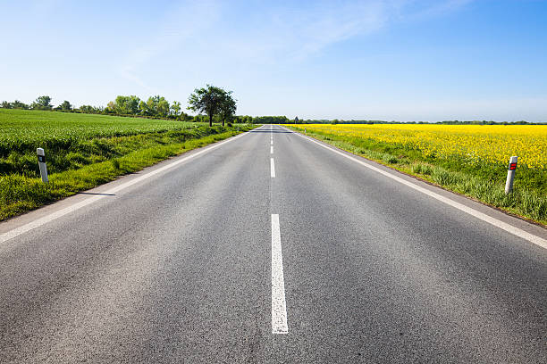
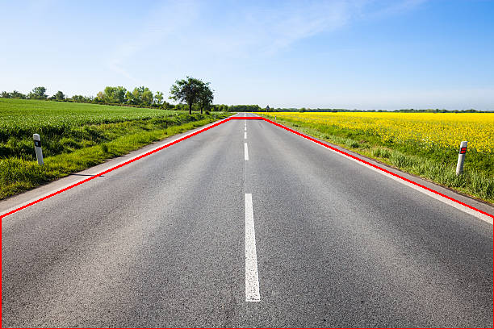
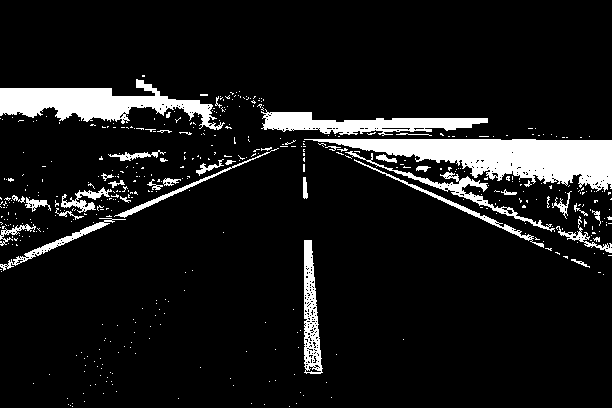
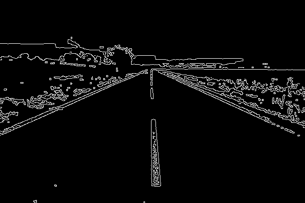
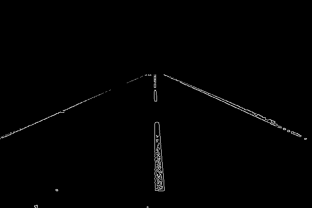
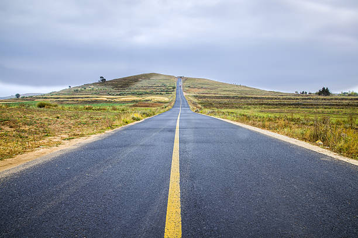
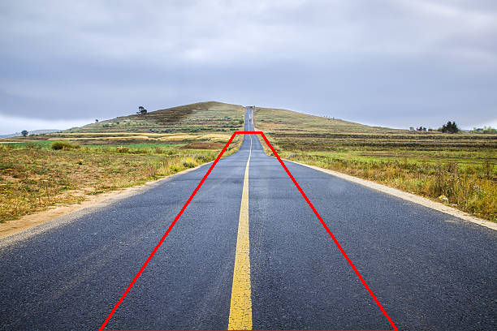
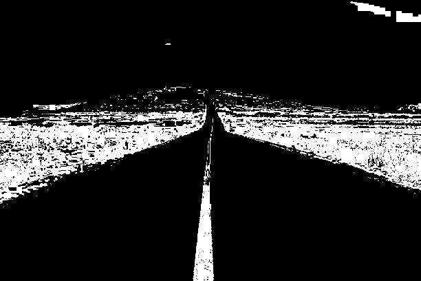
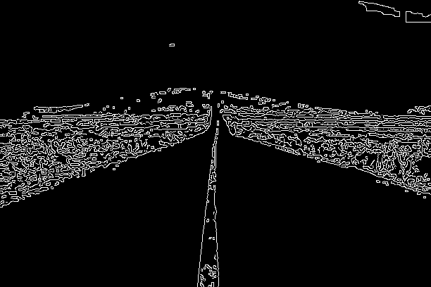
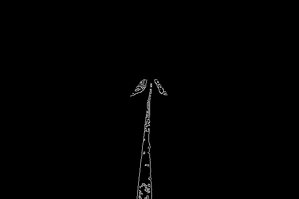

# Lane Line Extractor (Classical Computer Vision)

This is my Week 2 assignment for the CEAM Computer Vision team. I built a lane line extractor using OpenCV. It takes a static road image and keeps only the lane lines, using classical computer vision.

The pipeline has five steps:

1. Load the image
2. HSV color filter (keep white and yellow paint)
3. Gaussian blur
4. Canny edge detection
5. Region of Interest (ROI) mask

## How to run

You need Python 3.10+ and two libraries:

```
pip install opencv-python numpy
```

Then run this from inside the project folder:

```
python3 lane_extractor.py
```

It reads the images from `images/` and saves the result of every step into `results/`.

## Project structure

```
lane-line-extractor/
├── README.md
├── lane_extractor.py     the whole pipeline
├── images/
│   ├── lane1.jpg         test image 1
│   └── lane2.jpg      test image 2
└── results/              output images made by the script
```

## How the pipeline works

An image in OpenCV is a grid of numbers, like the grid I made by hand in Week 1, except each pixel has 3 values (blue, green, red).

### Step 1: Load the image
`cv.imread` loads the file. If the path is wrong it returns `None`, so I check for that and print a message instead of crashing.

### Step 2: HSV color filter
BGR mixes color and brightness together, so it is hard to say "this pixel is white". HSV splits a pixel into:

- **H (hue):** the actual color, 0 to 179 in OpenCV
- **S (saturation):** how strong the color is, 0 to 255
- **V (value):** brightness, 0 to 255

I used `cv.inRange` to make a black and white mask for each paint color, then joined them with `cv.bitwise_or`.

| Color | H | S | V |
|---|---|---|---|
| White paint | 0 to 180 | 0 to 25 | 215 to 255 |
| Yellow paint | 18 to 32 | 70 to 255 | 90 to 255 |

White paint has almost no color (low S) and is very bright (high V). Yellow paint has a hue around 18 to 32. Then `cv.bitwise_and` with the mask keeps only the white and yellow pixels and turns everything else black.

I started with typical HSV ranges for white and yellow, then adjusted them after looking at the color mask output. The yellow line in lane2.jpg is pale because of the cloudy light, so the minimum saturation had to be low (70).

### Step 3: Gaussian blur
`cv.GaussianBlur(img, (5, 5), 0)` blurs the image with a 5x5 kernel. It is like the box blur from the earlier project, but the center pixel is more weighted, so it looks smoother. This removes tiny specks so Canny does not treat them as edges.

### Step 4: Canny edge detection
First I convert to grayscale, because Canny needs single channel. Then `cv.Canny(gray, 50, 150)` finds places where the brightness changes sharply. Changes above 150 are definitely edges, changes below 50 are ignored, and the ones in between only count if they connect to a strong edge.

Canny draws the border of each shape, so a painted stripe shows up as an outline with two edges. This is why the center dashes look like hollow rectangles in the results.

### Step 5: Region of Interest (ROI) mask
After step 4 there are still edges from the sky, trees, fields and grass. I made a black image the same size as the photo, drew a white polygon over the road area with `cv.fillPoly`, and used `cv.bitwise_and` to keep only the edges inside that polygon.

Corners are written as fractions of the image width and height, like `(0.5, 0.4)` for 50% across and 40% down. I used a different polygon for each image because the roads look different:

- **lane1** uses a 6 point shape, because the white edge lines go all the way to the sides of the image and a narrow shape would cut them off.
- **lane2** uses a narrow 4 point shape around the yellow line, because the dry grass next to the road is also yellow-ish and would get through the color filter.

A polygon in red shape is shown in the preview. This indicates the polygon used for ROI masking.

## Results

### Image 1 (`lane1.jpg`)

Original:



| ROI preview | Color mask | Canny edges | Final result |
|---|---|---|---|
|  |  |  |  |

What this shows: the color mask picks up the white lines, but also the sky and the yellow flower field. The edge image then has a lot of extra edges from the trees and field. After the ROI mask, those are gone, and what is left is the two white edge lines and the dashed center line.

### Image 2 (`lane2.jpg`)

Original:



| ROI preview | Color mask | Canny edges | Final result |
|---|---|---|---|
|  |  |  |  |

What this shows: the yellow center line is picked up clearly in the color mask, but so is the dry grass on both sides, since it has a similar hue. The narrow ROI removes the grass, and the final result is the outline of the yellow line from the bottom of the image up to the horizon.

## Problems and limitations

- **Fixed numbers.** The HSV ranges, Canny thresholds and polygons were tuned by hand on these two images. A different road or different lighting would need new values.
- **Dry grass looks like yellow paint.** The color filter cannot separate them, so I rely on the ROI to remove the grass.
- **Small stray edges.** In image 2 a few small stray edges remain near the top of the polygon, where the road meets the grass.
- **The ROI is fixed per image.** If the camera angle changes, the polygon has to be changed too.
- **Outlines, not lines.** Canny gives outlines of the painted stripes, not single lines. Fitting actual lines to them (for example with a Hough transform) would be a later step.

## What I learned

- Lane lines can be detected and extracted using classical computer vision in the above 5 steps.
- Using color filter and Gaussian blur, we can effectively use Canny edge detection to identify the edges of the lanes.
- Using ROI masking, we can filter out unnecessary shapes, and map out the lane lines exclusively.
- HSV is much better than BGR for picking out a color, but you still have to find the numbers by experimenting. Estimation of values by hit and trial method is required.
- Saving the image after every step made it easy to see which step was causing a problem.
